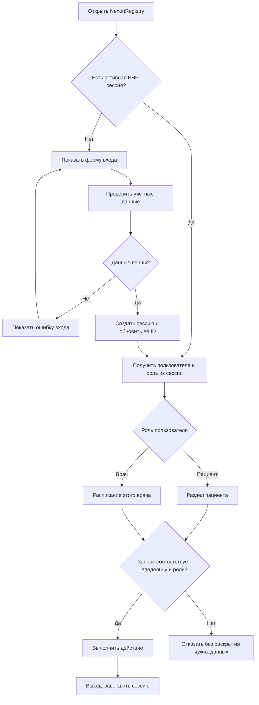
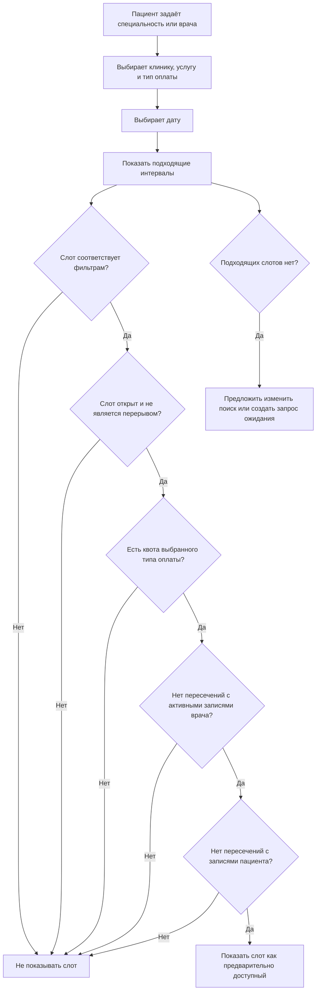
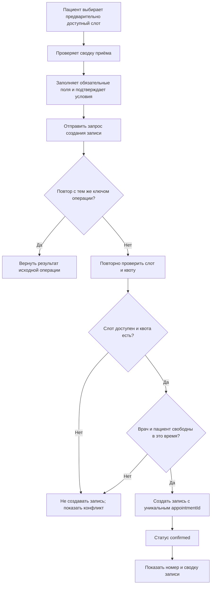
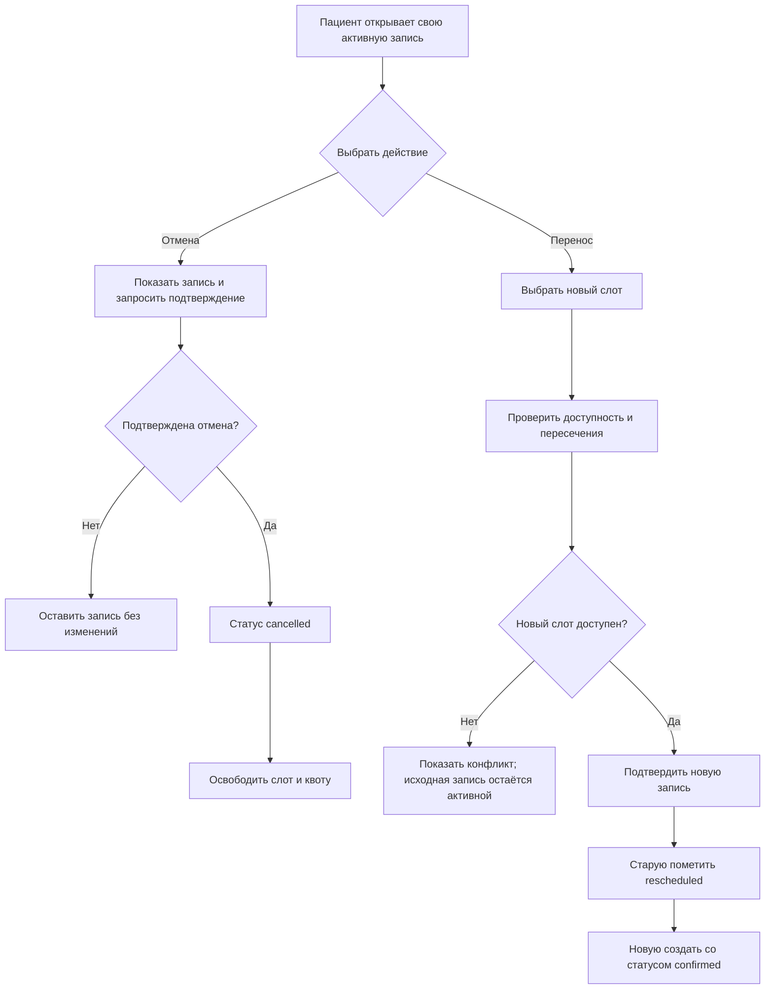
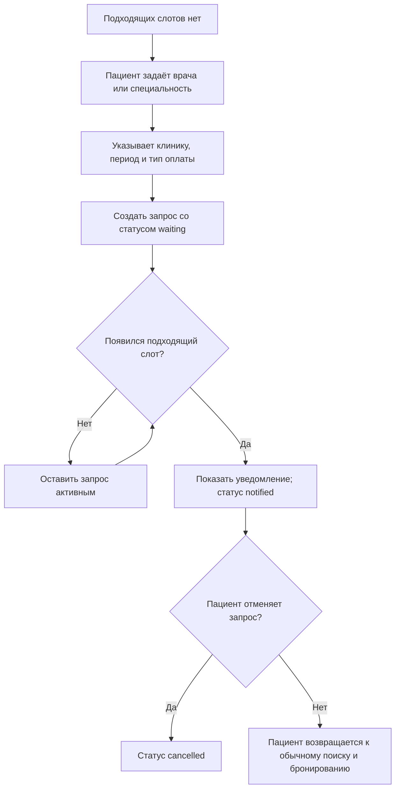
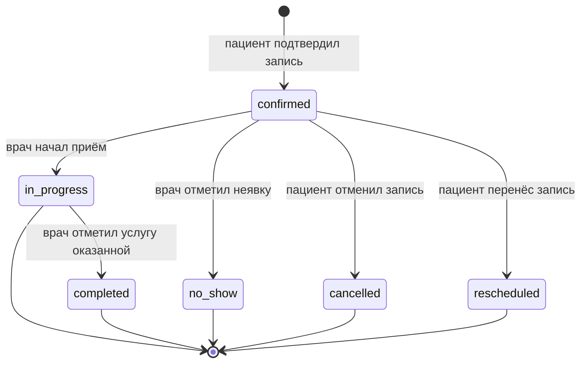
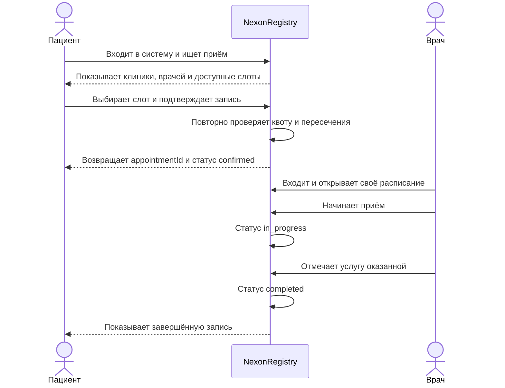

# Бизнес-логика NexonRegistry

## Назначение и границы

Документ описывает базовые пользовательские и предметные правила первой итерации NexonRegistry. Макет работает на HTML/CSS/JavaScript, PHP-обработчиках и синтетических данных. Схемы показывают поведение самой регистратуры: поиск, запись, управление записью и работу врача.

## 1. Авторизация и доступ по ролям

Идентификаторы `patientId` и `doctorId` для проверки доступа берутся из серверной сессии, а не из параметров, присланных браузером. Пациент работает только со своими записями; врач — только со своим расписанием.

## 2. Поиск и доступность слота

Пересечение определяется по времени начала и длительности услуги. Активные записи и занятые интервалы уменьшают доступную квоту. Изменение клиники, врача или услуги сбрасывает выбранные дату и слот, если они перестали подходить.

## 3. Создание записи

Подтверждение повторно проверяет доступность: выбор слота на экране не резервирует его. Повторная отправка одной операции не должна создавать вторую запись. В макете это правило демонстрируется фиктивными данными и обработчиками.

## 4. Перенос и отмена

Перенос сначала подтверждает новый слот и только затем освобождает старый. Пациент не может отменить или перенести чужую запись. Повтор отмены уже отменённой записи возвращает её текущий статус.

## 5. Лист ожидания

В первой итерации событие появления слота запускается демонстрационной кнопкой, а уведомление отображается в интерфейсе.

## 6. Работа врача и жизненный цикл записи

Врач видит только записи своего расписания. Он начинает приём и после оказания услуги переводит его в `completed`; при неявке использует `no_show`. Для `cancelled` и `rescheduled` запись показывается как итоговая, но врач не меняет её в базовом потоке.

## Сквозной сценарий MVP

## Статусы

| Объект | Статусы MVP |
|---|---|
| Запись | `confirmed`, `in_progress`, `completed`, `no_show`, `cancelled`, `rescheduled` |
| Запрос листа ожидания | `waiting`, `notified`, `cancelled` |

Все данные и результаты действий в первой итерации синтетические. PHP-обработчики могут использовать заранее подготовленные ответы и сессию для демонстрации состояния.
